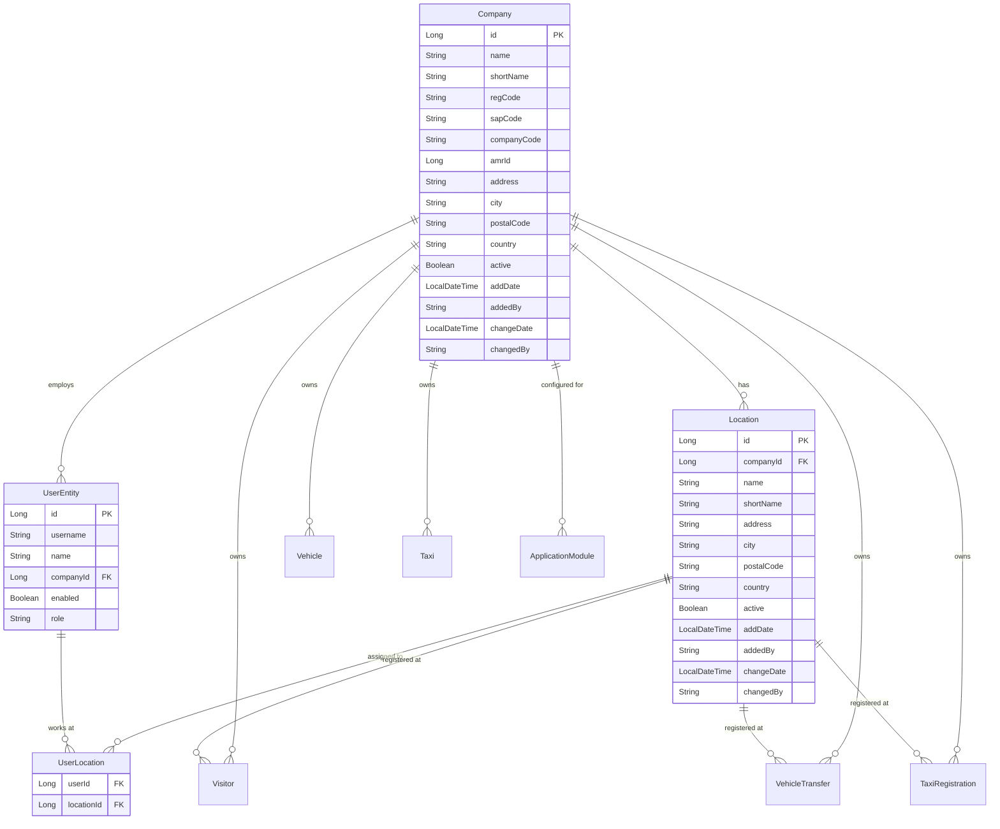
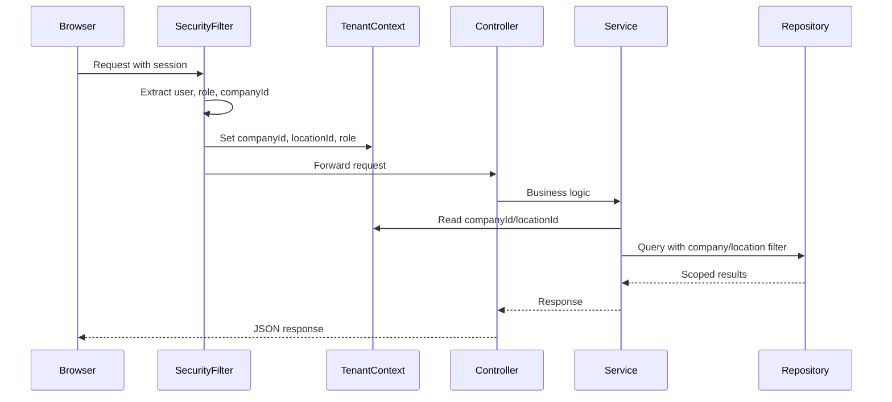

# Multi-Company and Multi-Location Support

## Current State

The application has a flat structure: one set of visitors, vehicles, and taxis shared globally. Two roles exist (`ADMIN`, `ASSISTENT`) with no organizational scoping. The `Institution` entity is used as a reference table for organization names but has no ownership relationship with data.

**Key files:**

- [User.java](c:\WebROOT\TARKVARA.NEW\visitor\visitor-back\src\main\java\ee\smit\vr\data\entity\User.java) - current `companyId` (string), `role` (ADMIN/ASSISTENT)
- [Institution.java](c:\WebROOT\TARKVARA.NEW\visitor\visitor-back\src\main\java\ee\smit\vr\data\entity\Institution.java) - will become Company
- [Visitor.java](c:\WebROOT\TARKVARA.NEW\visitor\visitor-back\src\main\java\ee\smit\vr\data\entity\Visitor.java) - no company/location FK
- [OAuth2SecurityConfig.java](c:\WebROOT\TARKVARA.NEW\visitor\visitor-back\src\main\java\ee\smit\vr\config\OAuth2SecurityConfig.java) - security config
- [auth.ts](c:\WebROOT\TARKVARA.NEW\visitor\visitor-vue\src\stores\auth.ts) - frontend auth store
- [AppNavigation.vue](c:\WebROOT\TARKVARA.NEW\visitor\visitor-vue\src\components\AppNavigation.vue) - navigation

---

## Target Architecture

### Role Hierarchy

```
GLOBAL_ADMIN
  Can manage ALL companies, locations, users
  Can switch company context to view/operate as that company
  Can access global admin panel

ADMIN (company-scoped)
  Can manage users and locations within their own company
  Can view/manage all data across all locations in their company
  Cannot see other companies' data

ASSISTENT (location-scoped)
  Can register visitors/vehicles/taxis at their assigned location(s)
  Can view data only from their assigned location(s)
  May have access to one or more locations within their company
```

### Data Model




### Request Context Flow




---

## Phase 1: Database Schema and Entities

### Flyway Migrations

**V1_28__rename_institution_to_company.sql**

- Rename table `institution` to `company`
- Add new columns: `address`, `city`, `postal_code`, `country`
- Update column names if needed for consistency

**V1_29__create_location_table.sql**

- Create `location` table with: `id`, `company_id` (FK), `name`, `short_name`, `address`, `city`, `postal_code`, `country`, `active`, audit fields
- Add index on `company_id`

**V1_30__update_user_for_multitenancy.sql**

- Change `user.company_id` from `VARCHAR(255)` to `BIGINT` (FK to `company.id`)
- Add index on `company_id`
- Update `user.role` to support `GLOBAL_ADMIN`

**V1_31__create_user_location_table.sql**

- Create `user_location` join table: `user_id` (FK), `location_id` (FK)
- Primary key on `(user_id, location_id)`

**V1_32__add_tenancy_to_data_tables.sql**

- Add `company_id` (BIGINT) and `location_id` (BIGINT) to: `visitors`, `vehicle`, `vehicle_transfer`, `taxi`, `taxi_register`
- Add indexes on both columns for each table

**V1_33__seed_default_company_and_location.sql**

- Create a "Default" company from the first existing institution (or create new)
- Create a "Default" location under that company
- Assign all existing data (visitors, vehicles, taxis) to the default company/location
- Assign all existing users to the default company

### Entity Changes

- **Rename** `Institution` entity to `Company`; add address fields, update `@Table(name = "company")`
- **Create** `Location` entity with `@ManyToOne` to `Company`
- **Create** `UserLocation` entity (or use `@ManyToMany` on `User`)
- **Update** `User` entity: `companyId` becomes `@ManyToOne Company company`; add `@ManyToMany Set<Location> locations` via `user_location`
- **Update** `Visitor`, `Vehicle`, `VehicleTransfer`, `Taxi`, `TaxiRegistration`: add `@ManyToOne Company` and `@ManyToOne Location`

---

## Phase 2: Backend Tenant Context and Security

### TenantContext

Create a `TenantContext` (ThreadLocal-based) that holds:

- `companyId` - the current company context
- `locationId` - the current location context (nullable for ADMIN-level operations)
- `role` - GLOBAL_ADMIN / ADMIN / ASSISTENT

**File:** `src/main/java/ee/smit/vr/security/TenantContext.java`

### TenantFilter

A servlet filter (or `OncePerRequestFilter`) that runs after authentication:

1. Reads the authenticated user from `SecurityContext`
2. Loads user's `companyId` and assigned `locationIds` from the database
3. If `GLOBAL_ADMIN` and a `X-Company-Id` header is present, use that as context (company switching)
4. Populates `TenantContext`

**File:** `src/main/java/ee/smit/vr/security/TenantFilter.java`

### Security Configuration Updates

- [OAuth2SecurityConfig.java](c:\WebROOT\TARKVARA.NEW\visitor\visitor-back\src\main\java\ee\smit\vr\config\OAuth2SecurityConfig.java):
  - Add `GLOBAL_ADMIN` role to URL matchers
  - Register `TenantFilter` in the filter chain after the OAuth2 filter
  - Company/location management endpoints: `hasRole('GLOBAL_ADMIN')` or `hasRole('ADMIN')`

### Updated Authorization Rules


| Endpoint            | GLOBAL_ADMIN            | ADMIN                      | ASSISTENT       |
| ------------------- | ----------------------- | -------------------------- | --------------- |
| `/api/companies/`** | Full CRUD               | Read own                   | --              |
| `/api/locations/`** | Full CRUD               | CRUD within company        | Read assigned   |
| `/api/users/`**     | Full CRUD               | CRUD within company        | --              |
| `/api/visitors/**`  | All (scoped by context) | Company-scoped             | Location-scoped |
| `/api/vehicles/**`  | All (scoped by context) | Company-scoped             | Location-scoped |
| `/api/taxis/**`     | All (scoped by context) | Company-scoped             | Location-scoped |
| `/api/modules/**`   | Full CRUD               | Read/toggle within company | --              |
| `/actuator/**`      | Full                    | --                         | --              |


---

## Phase 3: Backend Service and Repository Scoping

### Repository Changes

Every data repository needs scoped query methods:

- `VisitorRepository`: add `findByCompanyIdAndLocationId(...)`, `findByCompanyId(...)`
- `VehicleRepository`, `VehicleTransferRepository`, `TaxiRepository`, `TaxiRegistrationRepository`: same pattern
- `Specification` classes: add `companyId` and `locationId` predicates

### Service Layer Changes

All services that currently query data globally must use `TenantContext` to scope:

```java
// Example pattern for all data services
public List<VisitorResponse> getVisitors(...) {
    Long companyId = TenantContext.getCompanyId();
    Long locationId = TenantContext.getLocationId(); // null for ADMIN
    
    if (locationId != null) {
        return repo.findByCompanyIdAndLocationId(companyId, locationId, ...);
    }
    return repo.findByCompanyId(companyId, ...);
}
```

### New Services

- **CompanyService** - CRUD for companies (replaces InstitutionService)
- **LocationService** - CRUD for locations within a company
- **UserService updates** - assign users to companies and locations

### New Controllers

- **CompanyController** - `/api/companies` (replaces InstitutionController)
- **LocationController** - `/api/locations` or `/api/companies/{id}/locations`

---

## Phase 4: Frontend Changes

### Auth Store Updates

[auth.ts](c:\WebROOT\TARKVARA.NEW\visitor\visitor-vue\src\stores\auth.ts):

- Add to `User` interface: `companyId`, `companyName`, `locationIds`, `locationNames`
- Add state: `currentCompanyId`, `currentLocationId`
- Add actions: `switchCompany(companyId)`, `switchLocation(locationId)`
- `GLOBAL_ADMIN` gets a company list to switch between
- `ASSISTENT` with multiple locations gets a location selector

### Navigation Updates

[AppNavigation.vue](c:\WebROOT\TARKVARA.NEW\visitor\visitor-vue\src\components\AppNavigation.vue):

- Add **Company Switcher** dropdown (visible only for `GLOBAL_ADMIN`): shows all companies, current one highlighted
- Add **Location Selector** (visible for users with multiple locations): dropdown or badge showing current location
- Update management dropdown:
  - "Ettevotete haldus" (Company management) - `GLOBAL_ADMIN` only
  - "Asukohtade haldus" (Location management) - `ADMIN` and `GLOBAL_ADMIN`
  - Existing items remain, scoped by new roles

### New Views

- **CompanyManagementView.vue** - CRUD for companies (`GLOBAL_ADMIN`)
- **LocationManagementView.vue** - CRUD for locations within current company (`ADMIN`, `GLOBAL_ADMIN`)

### Updated Views

- **UserManagementView** - add company assignment (for `GLOBAL_ADMIN`), location assignment (for `ADMIN`)
- **VisitorsView, VehicleView, TaxiView** - add location indicator; data automatically scoped by backend
- **Archive views** - same scoping; optionally allow filtering by location

### Router Updates

[index.ts](c:\WebROOT\TARKVARA.NEW\visitor\visitor-vue\src\router\index.ts):

- Add `/company-management` route (`requiresGlobalAdmin: true`)
- Add `/location-management` route (`requiresAdmin: true`)
- Add `requiresGlobalAdmin` meta type
- Update guard to check for `GLOBAL_ADMIN` role

### API Service Updates

All API calls need to include the current company/location context:

- Add `X-Company-Id` and `X-Location-Id` headers to API requests (via axios interceptor)
- Or pass as query parameters

---

## Phase 5: Data Migration Strategy

For existing installations:

1. Create a default company from the first (or most-used) institution
2. Create a default location under that company
3. Assign all existing users to the default company
4. Assign all users to the default location in `user_location`
5. Set `company_id` and `location_id` on all existing visitors, vehicles, taxis
6. Promote existing `ADMIN` users to keep their role, or optionally one to `GLOBAL_ADMIN`

---

## Implementation Order (Recommended)

The phases should be implemented in order. Within each phase, the backend should be completed before the frontend since the frontend depends on API endpoints.

- **Phase 1** - Schema and entities (foundation, no behavior change)
- **Phase 2** - Tenant context and security (enables scoping)
- **Phase 3** - Service/repository scoping (enforces data isolation)
- **Phase 4** - Frontend updates (user-facing changes)
- **Phase 5** - Migration script for existing data

---

## Risk Assessment

- **Breaking change**: All existing data must be migrated to have company/location; migration script is critical
- **Performance**: Additional JOINs and WHERE clauses on every query; indexes on `company_id` and `location_id` are essential
- **OAuth2/UAA**: The UAA itself does not need changes - role and company assignment happen in the visitor app
- **Testing**: Every existing test needs updating since data queries will fail without tenant context; a test base class should set up default tenant context

